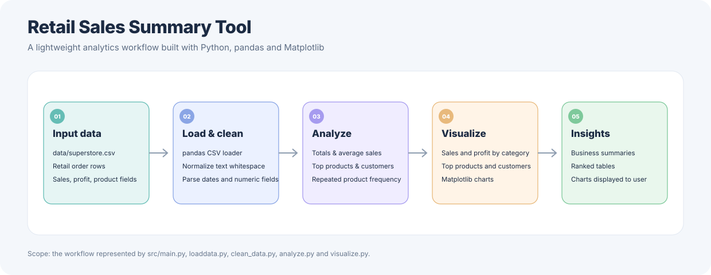
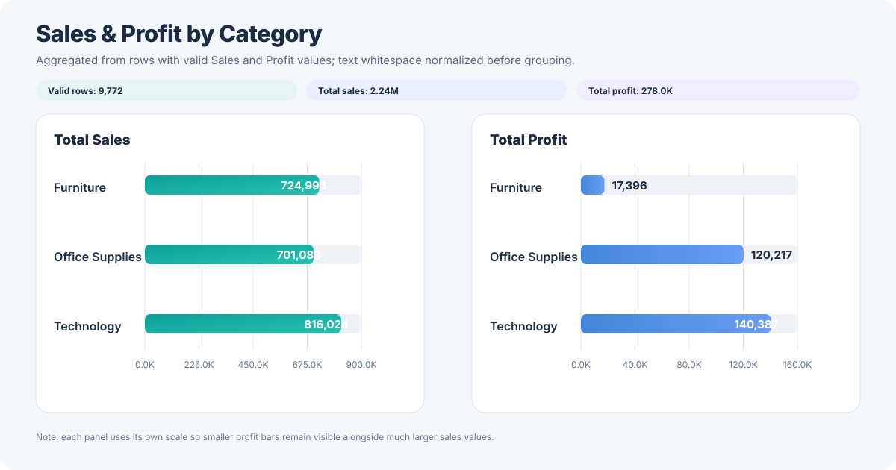
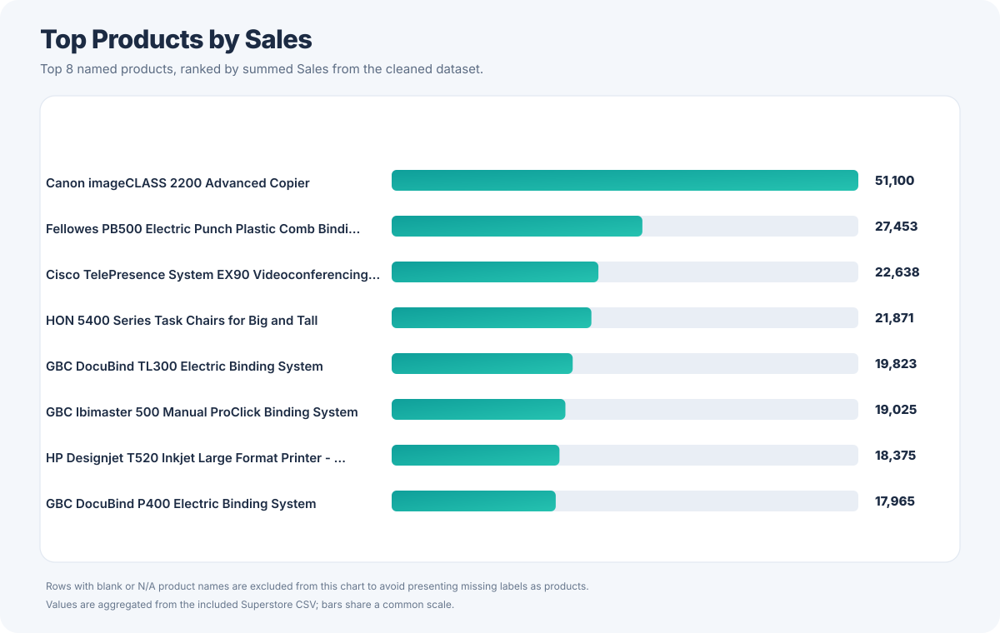
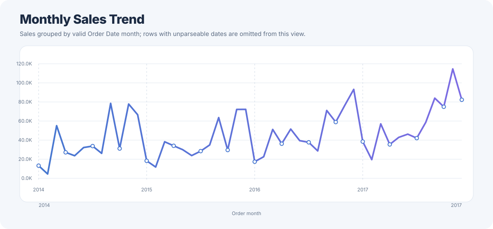

# Retail Sales Summary Tool

[](https://github.com/shahinashiny/Assignment2_Retail_Sales_Summary_Tool/actions/workflows/python-ci.yml)

A Python and pandas project that cleans a retail Superstore dataset, summarizes sales and profit, identifies top products and customers, and generates charts for quick business review.

## Project summary

Built a Python/pandas retail analytics workflow that loads and cleans transaction data, normalizes inconsistent text, parses date and numeric fields, filters rows with invalid `Sales`/`Profit` values, and produces sales/profit summaries plus category, product, customer, and repeat-product visualizations. The repository includes pytest tests and GitHub Actions CI for Python 3.10–3.12, with Ruff linting and formatting checks.


## Project highlights

- Loads retail transaction data from CSV.
- Normalizes column names and text values, including extra whitespace.
- Parses order and ship dates and converts key numeric fields.
- Excludes rows with missing or invalid `Sales` or `Profit` values from the analysis.
- Calculates total sales, total profit, and average sales.
- Ranks products and customers by sales and identifies frequently occurring products.
- Creates charts for category sales/profit, top products, top customers, and repeated products.

## Technology stack

- Python 3.10+
- pandas
- matplotlib
- pytest (tests)

## Repository structure

```text
.
├── .github/
│   └── workflows/
│       └── python-ci.yml
├── data/
│   ├── superstore.csv
│   └── README.md
├── docs/
│   ├── architecture.svg
│   ├── monthly_sales_trend.svg
│   ├── sales_profit_by_category.svg
│   ├── top_products_by_sales.svg
│   ├── README.md
│   └── sample_output.md
├── src/
│   ├── main.py
│   ├── loaddata.py
│   ├── clean_data.py
│   ├── analyze.py
│   └── visualize.py
├── tests/
│   └── test_pipeline.py
├── requirements.txt
├── requirements-dev.txt
├── pyproject.toml
├── .gitignore
└── README.md
```

## Architecture and data visualizations

The following diagrams are generated from the project flow and the checked-in `data/superstore.csv`.

### Workflow architecture



### Sales and profit by category



### Top named products



This ranking omits blank or `N/A` product labels so the chart focuses on identifiable product names.

### Monthly sales trend



The monthly chart excludes rows whose order date cannot be parsed as a valid month/day/year value. The charts are static SVGs generated from the checked-in data; rerun the analysis and refresh the charts when the source data changes.

## Run locally

Run all commands from the repository root directory.

### 1. Create and activate a virtual environment

**Windows PowerShell**
```powershell
python -m venv .venv
.venv\Scripts\Activate.ps1
```

**macOS / Linux**
```bash
python -m venv .venv
source .venv/bin/activate
```

### 2. Install dependencies

```bash
python -m pip install --upgrade pip
pip install -r requirements.txt
```

### 3. Run the analysis

```bash
python src/main.py
```

The script prints summary metrics and ranked tables, then opens Matplotlib chart windows. Close each chart window to continue to the next visualization.

### 4. Run the tests

```bash
python -m pytest tests/
```

The tests cover data loading, cleaning behavior, and core summary calculations. Run them from the repository root so Python can resolve the project modules.

## Continuous integration and code quality

GitHub Actions runs on pushes and pull requests targeting `main`, and can also be started manually from the Actions tab.

The workflow runs the unit tests on Python 3.10, 3.11, and 3.12:

```bash
python -m pytest tests/ -v
```

A separate quality job uses [Ruff](https://docs.astral.sh/ruff/) to lint the source and tests and check code formatting:

```bash
python -m pip install -r requirements-dev.txt
python -m ruff check src tests
python -m ruff format --check src tests
```

Ruff rules and formatting options are defined in `pyproject.toml`. The `.gitignore` excludes Python bytecode, virtual environments, local environment files, test/lint caches, and build output.

Workflow file: [`.github/workflows/python-ci.yml`](.github/workflows/python-ci.yml).

## Data and cleaning rules

The main input is `data/superstore.csv`. Important fields include `Order Date`, `Ship Date`, `Category`, `Product Name`, `Customer Name`, `Sales`, `Quantity`, `Discount`, and `Profit`.

The cleaning step:

1. Removes surrounding and repeated whitespace from text fields.
2. Converts `Order Date` and `Ship Date` to datetime values when present.
3. Converts `Sales`, `Profit`, `Quantity`, and `Discount` to numeric values when present.
4. Drops rows where `Sales` or `Profit` is missing or cannot be converted.

This is a small portfolio/learning project rather than a production-grade data-quality framework. Invalid dates are coerced to missing date values; the current logic does not automatically remove a row solely because its date is invalid.

## Example results

Reference values from the included dataset, rounded to two decimal places:

| Metric | Value |
|---|---:|
| Total sales | 2,242,104.82 |
| Total profit | 278,000.04 |
| Average sales per retained row | 229.44 |
| Rows retained for sales/profit analysis | 9,772 |

Top product sales and category summaries are documented in [docs/sample_output.md](docs/sample_output.md). Values will change if the input data or cleaning rules change.

## Repository privacy note

An unrelated dataset was removed from the current version because it is not used by this retail-sales project.

**Keep this repository private for now.** Removing a file from the current version does not erase it from earlier Git commits. Before making this repository public, review and clean the Git history so the removed file is not accessible from old commits. Also confirm that the Superstore dataset is suitable for redistribution.

## Author

**Shahina Shaik**

- [GitHub](https://github.com/shahinashiny)
- [LinkedIn](https://www.linkedin.com/in/shahina-shaik-8ba21a24a)
- [Portfolio](https://benevolent-wisp-556282.netlify.app/)
